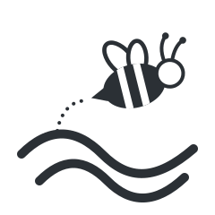

<p align="center">
  <picture>
    <source media="(prefers-color-scheme: dark)" srcset="assets/logo/crest-reversed.svg">
    
  </picture>
</p>

# BeeWave: Rust ESP32 + Web Bluetooth PWA

See [docs/ARCHITECTURE.md](docs/ARCHITECTURE.md). Logo and colours: [docs/BRANDING.md](docs/BRANDING.md).

```
nix develop        # or: direnv allow     (all tools)
make help
make setup         # once: Xtensa toolchain + pnpm deps
make test          # host tests, no hardware
make web-mock      # UI with a fake device
make fw-run        # build + flash + monitor (board on PORT=/dev/ttyACM0)
```

Layout: `crates/{protocol,core}` (host-testable) · `firmware/` (ESP-IDF adapters) · `web/` (PWA).
Web Bluetooth needs HTTPS or localhost and Chrome/Edge (Android/desktop); iOS Safari is unsupported.
